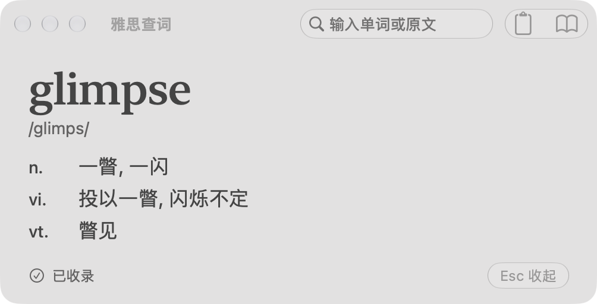
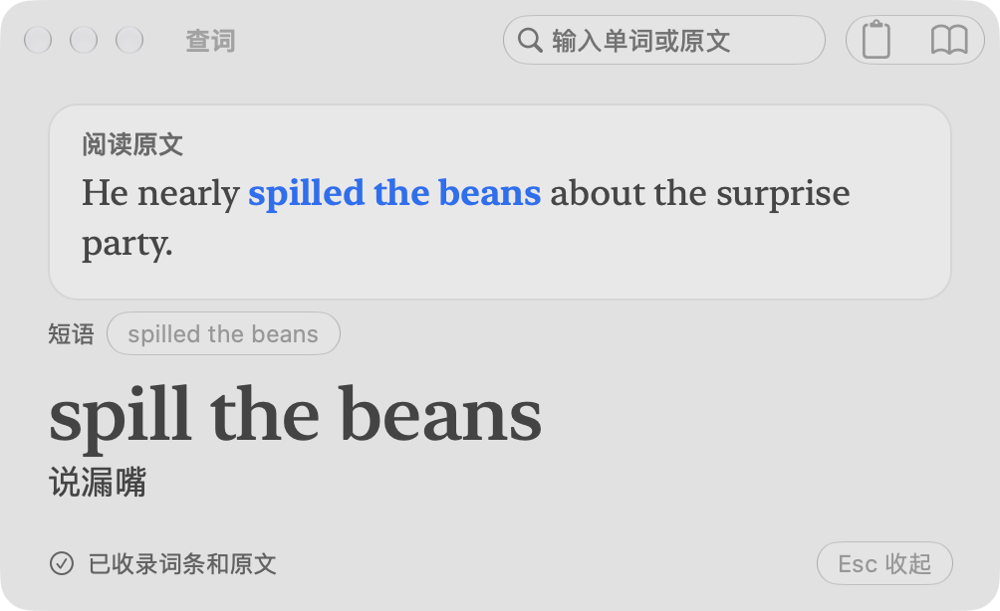
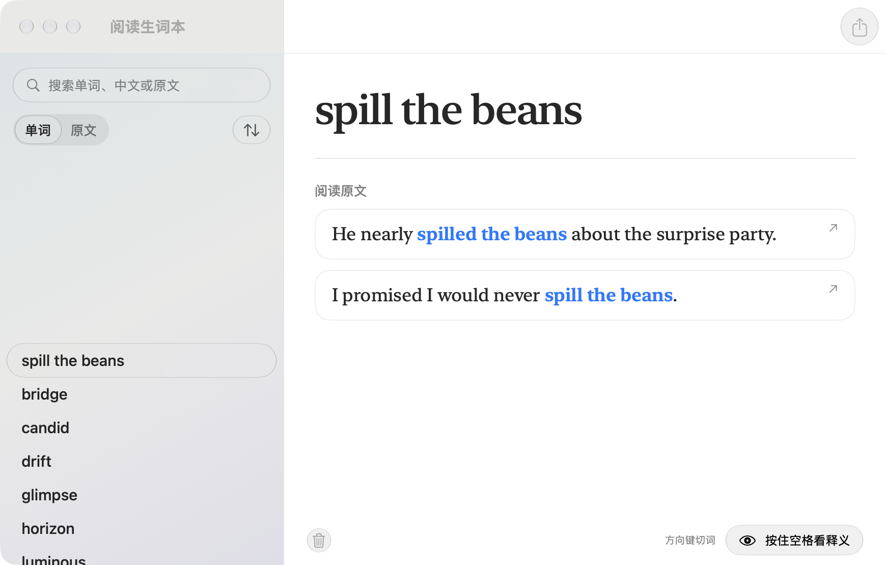

# 查词 · Mac 上的即时查词浮窗

**复制英文，按 ⌥D，中文释义就浮在原文旁。** 在网页、PDF 或电子书里遇到生词，手不用离开键盘。看懂了，按 Esc 接着读。词典随 App 安装，断网也能查，收录和补例句都在后台进行。

[**下载「查词」Mac 版（DMG）**](https://github.com/yuanran-hub/option-d/releases/latest/download/Chaci.dmg) · [使用截图](#使用截图) · [版本记录](https://github.com/yuanran-hub/option-d/releases)

macOS 26 及以上 · 支持 Apple 芯片与 Intel · 免费开源

## 使用截图

**一个词，按下就查。** 复制 `glimpse`，按 ⌥D，音标和中文释义一起出现。浮窗可以留在屏幕上，对照原文慢慢读。



查一次有多快？在一台 Apple M2 Mac 上，应用已运行时测了 51 次单词查询。从浮窗收到文本到更新释义，中位数为 **15 毫秒**，95% 的查询在 **约 56 毫秒**内完成。计时从应用收到文本开始，不含系统派发快捷键、屏幕刷新及首次启动。

**每个词都认识，连起来却读不懂？** 连句子一起复制，按 ⌥D。点一个词就查单词，点浮窗识别出的短语或直接拖过几个词，就查整段表达。比如下面这句里的 `spilled the beans`，点一下就知道是「说漏嘴」。遇到 `She turned the offer down.` 这样的拆分短语，点 `turn down` 会同时高亮 `turned` 和 `down`。只复制词典收录的完整短语，也能直接出释义。



**下次复习，还能看见当时那句话。** 在另一篇文章里又遇到同一个词，新原句会添在同一词条下。打开菜单栏「词」里的阅读生词本，先看原句回想，按住空格看释义，松开遮住，用方向键切词。想换个顺序，选「随机顺序」或点「重新洗牌」。时间和字母都支持正序、倒序。



## 安装

1. 打开下载的磁盘映像，把「查词」拖到「应用程序」。
2. 从「应用程序」打开「查词」。看到 Mac 菜单栏的「词」，复制一个英文单词，按 **⌥D** 就能试用。要在开机登录后随时查词，可将它加入 macOS 登录项。登录后只在菜单栏显示「词」，按 ⌥D 时才弹出浮窗。

从 1.10 或更早的公开版升级时，先从菜单栏退出旧版，再把「应用程序」中的旧 App 改名为「查词」，将新版拖入并选择替换。启动后，原有生词本会自动载入。

公开版尚未经过 Apple 公证。如果首次打开时系统提示无法验证开发者，请先确认文件来自本仓库，再到「系统设置 → 隐私与安全性」找到「查词」，点「仍要打开」。[Apple 官方说明](https://support.apple.com/zh-cn/102445)

## 词典与生词本

- **查释义**用本机 ECDICT 英汉词典。应用只在你主动查词时读取剪贴板。遇到本机未收录的短语，可以点「联网查短语」在有道查询所选表达。
- **记语境**时，词形依据词典归入原形，同一条原文自动去重。单独查词会优先配上本地 Wordset 例句，缺例句时才在后台用该词向 Free Dictionary API 尝试补充。
- **翻词库**时，可以搜单词、中文或原句，也可以删除词条、撤销删除，或用工具栏导出和备份。

## 数据与许可

个人词条、原句以及 Word、HTML、JSON 导出保存在 `~/Library/Application Support/OptionD/Reading/`。生词本工具栏可导出和备份。

应用代码使用 [MIT 许可证](LICENSE)。ECDICT 使用 MIT；Wordset 例句按 CC BY-SA 4.0 提供，并保留其 WordNet 声明。构建脚本从指定上游版本提取例句并创建本地索引。在线补充例句保留接口返回的来源与许可信息。[ECDICT](https://github.com/skywind3000/ECDICT) · [Wordset](https://github.com/wordset/wordset-dictionary) · [第三方许可](licenses/)

## 在 Mac 上构建

需要 macOS 26 或更新版本，以及带有 macOS 26 或更新 SDK 的 Xcode Command Line Tools。构建使用命令行工具自带的 Python 3.9 或更新版本。首次构建需要联网下载词典与 Python 依赖。

```sh
git clone https://github.com/yuanran-hub/option-d.git
cd option-d
bash build.sh
open "build/查词.app"
```

制作可分发的通用安装包可运行 `bash build.sh --dmg`，生成的文件在 `build/查词.dmg`。

## 运行测试

完成开发版构建后，可运行查词与洗牌测试。

```sh
PYTHONDONTWRITEBYTECODE=1 PYTHONPATH="$PWD/build/查词.app/Contents/Resources/runtime/vendor" \
OPTION_D_DICTIONARY_DATA="$PWD/.build/data" \
  /usr/bin/python3 -m unittest discover -s runtime
xcrun swiftc book/BookData.swift tests/ShuffleTests.swift -o .build/shuffle-tests
.build/shuffle-tests
```
