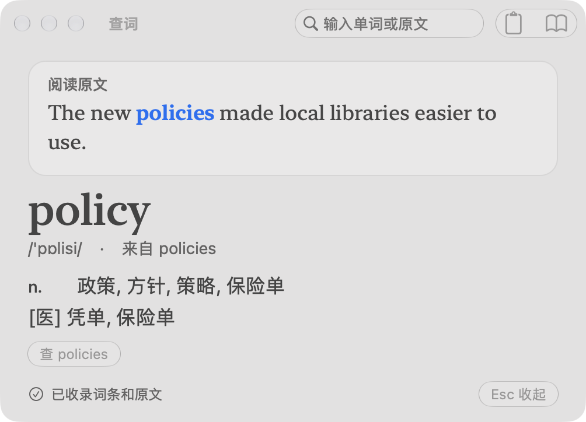

# Option D · 阅读查词

复制英文，按 **⌥D**。复制单个词会直接显示中文释义和音标；复制一句话，可以在毛玻璃浮窗里点选想查的词。按 **Esc** 收起浮窗，回到阅读。



## 在 Mac 上构建

需要 macOS 26 或更新版本，以及带有 macOS 26 或更新 SDK 的 Xcode Command Line Tools。构建使用命令行工具自带的 Python 3.9 或更新版本。首次构建需要联网下载词典与 Python 依赖。

```sh
git clone https://github.com/yuanran-hub/option-d.git
cd option-d
bash build.sh
open "build/Option D.app"
```

生成的 App 可以移到「应用程序」。启动后，菜单栏会出现「词」。如果日常使用，可以将 App 加入 macOS 的登录项。

## 查词与复习

- **复制 → ⌥D**，在本机 ECDICT 词典查义。只有主动查词时才读取剪贴板。
- **点原文里的词**，保留整段原文，并根据词典和句中词形归入原形。同一个词在不同句子出现时，生词本会保留各句。
- **打开菜单栏「词」→「打开阅读生词本」**，用方向键切词，按住空格看释义，松开即遮住。支持按收录时间或字母双向排序、搜索、删除和撤销。
- **只查一个词时**，优先使用本机 Wordset 例句。若本地缺例句，后台会把单词发给 Free Dictionary API 尝试补充。复制的原句留在本机。释义先显示，例句和文稿在后台处理。

## 数据与许可

个人词条、原句以及 Word、HTML、JSON 导出保存在 `~/Library/Application Support/OptionD/Reading/`。生词本工具栏可导出和备份。

应用代码使用 [MIT 许可证](LICENSE)。ECDICT 使用 MIT；Wordset 例句按 CC BY-SA 4.0 提供，并保留其 WordNet 声明。构建脚本从指定上游版本提取例句并创建本地索引。在线补充例句保留接口返回的来源与许可信息。[ECDICT](https://github.com/skywind3000/ECDICT) · [Wordset](https://github.com/wordset/wordset-dictionary) · [第三方许可](licenses/)

## 运行测试

先完成构建，然后运行：

```sh
PYTHONDONTWRITEBYTECODE=1 PYTHONPATH="$PWD/build/Option D.app/Contents/Resources/runtime/vendor" \
OPTION_D_DICTIONARY_DATA="$PWD/.build/data" \
  /usr/bin/python3 -m unittest discover -s runtime
```
